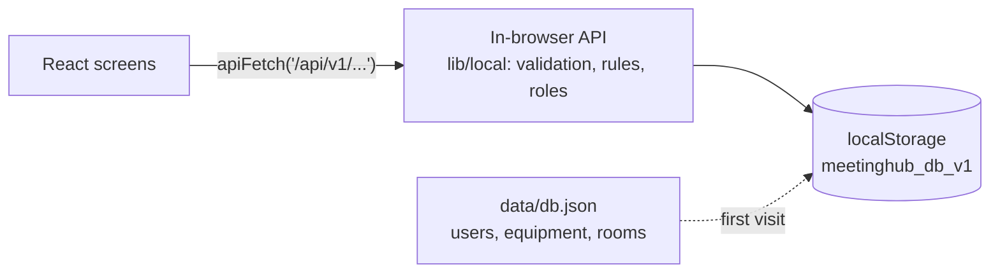

<div align="center">

# MeetingHub

**A meeting room booking app that runs entirely in the browser.**

Find a room, book it in seconds, get it approved, and check in with a QR code. No server, no database.


</div>

MeetingHub is a static Next.js application. The starting data (users, equipment, rooms) lives in a JSON file,
[apps/web/data/db.json](apps/web/data/db.json), and everything people create afterwards (bookings, notifications,
passwords, room changes) is kept in the browser's `localStorage`. The same `/api/v1` calls the screens make are answered
by code that runs in the browser, so there is nothing to host except the pages themselves.

> **Read this first: data is per browser.** Nothing is shared between people or devices. A booking made in one browser
> is invisible in another, and clearing the site data erases it. That makes this a demo, a prototype, or a single-computer
> kiosk, **not** a multi-user booking system. See [What this design cannot do](#what-this-design-cannot-do).

## Contents

- [Features](#features)
- [How it works](#how-it-works)
- [Quick start](#quick-start)
- [Changing the starting data](#changing-the-starting-data)
- [Deploy to Vercel](#deploy-to-vercel)
- [What this design cannot do](#what-this-design-cannot-do)
- [Development](#development)
- [Reference](#reference)

## Features

**Booking**

- Room search by capacity, building and equipment, with live availability
- One-time and weekly recurring bookings, limited by opening hours and a 30-day advance window
- No double bookings: overlapping and maintenance times are refused
- Cancel one meeting or a whole weekly series; invite colleagues by name or email
- Shared calendar, per-room day timeline, personal bookings and a list of meetings you are invited to
- Approval workflow for rooms that need it, with a written reason when a request is rejected
- Check-in from the booking list or by QR code; missed bookings become no-shows and release the room

**Operations**

- Room management: create, edit, activate or deactivate, upload photos (JPG, PNG, WebP)
- Maintenance blocks, dashboard, monthly booking reports with CSV export, and an audit log
- In-app notifications for invitations, approvals, cancellations and check-in reminders

**Accounts**

- Email and password sign-in, roles (User, Facility Admin, Admin), temporary passwords that must be replaced
- Sign-in lockout after repeated failures; a "forgot password" request that reaches the administrators

| Role | Can do |
| --- | --- |
| User | Search rooms, create and manage own bookings, check in |
| Facility Admin | Everything a User can, plus rooms, photos, maintenance, approvals and reports |
| Admin | Everything above, plus users, password resets and the audit log |

## How it works



```text
apps/web
├── app, features      Pages and UI
├── lib/api.ts         The one place the UI calls the API
├── lib/local          The in-browser API
│   ├── router.ts        /api/v1 routes, handled one request at a time
│   ├── handlers         accounts, rooms, bookings, operations (the business rules)
│   ├── database.ts      The data document and its types, read from and saved to storage
│   ├── password.ts      PBKDF2-SHA256 hashing with the Web Crypto API
│   └── validation.ts    Zod schemas for every request
├── data/db.json       Starting data
├── scripts            build-seed.mjs, hash-password.mjs
└── tests              Unit tests and API tests (tests/local)
```

- The API code is loaded on the first request, so it stays out of the first screen.
- Every request reads the current data, runs, and saves only if something changed. Two tabs of the same browser
  therefore see each other's changes.
- There is no scheduler: before each request the app catches up, sending check-in reminders and marking no-shows and
  completed bookings.
- Photos are shrunk in the browser (largest side 960 px) and stored inside the room record as data URLs.

## Quick start

Requires **Node.js 20+**. No database, no environment variables.

```bash
cd apps/web
npm install
npm run dev
```

Open <http://localhost:3000>. The sign-in page lists every demo account, with a button that fills the form, so a demo
can switch between people without explaining anything:

| Role | Name | Email | Password |
| --- | --- | --- | --- |
| Admin | System Administrator | `admin@meetinghub.com` | `Admin123!` |
| Facility admin | Facility Manager | `facility@meetinghub.com` | `Facility123!` |
| User | MeetingHub User | `user@meetinghub.com` | `User123!` |
| User | Somchai Jaidee | `somchai@meetinghub.com` | `User123!` |
| User | Nattaya Srisuk | `nattaya@meetinghub.com` | `User123!` |

The list comes from [data/demo-accounts.json](apps/web/data/demo-accounts.json); set `NEXT_PUBLIC_SHOW_DEMO_ACCOUNTS=false`
to hide it. A browser that already holds older data gets any new demo accounts added automatically. To start over, clear the site's data in your browser
(DevTools → Application → Local storage, remove `meetinghub_db_v1` and `meetinghub_session`).

## Changing the starting data

The first time a browser opens the app it copies `data/db.json` into its own storage. After that the browser's copy is
the truth, so editing the JSON only affects browsers that have not opened the app yet (or that cleared their data).

To change the users, equipment or rooms, edit the lists at the top of
[scripts/build-seed.mjs](apps/web/scripts/build-seed.mjs) and run:

```bash
npm run seed:build                      # rewrites data/db.json and data/demo-accounts.json
npm run password:hash -- "a password"   # prints a hash to paste into data/db.json by hand
```

Passwords in the JSON are stored as PBKDF2 hashes, never as plain text. Room photos are plain files in
`public/rooms/`; point a room's `image_url` at `/rooms/your-file.png`.

## Deploy to Vercel

There is nothing to configure.

1. Import the repository in Vercel and set **Root Directory** to `apps/web`.
2. Deploy. The default Next.js build is used (`npm run build`).
3. Optional: set `NEXT_PUBLIC_APP_URL` to your public address (used in the sitemap and social previews; the Vercel
   production domain is picked up automatically) and `NEXT_PUBLIC_SHOW_DEMO_ACCOUNTS=false` to hide the demo accounts
   on the sign-in page.

No database, storage, cron job or secret is needed. See [.env.example](apps/web/.env.example) for the optional variables.

## What this design cannot do

Because all data sits in each visitor's browser, and there is no server:

- **No shared state.** Two people never see each other's bookings, so they can book the same room at the same time.
  Invitations and notifications reach only people who use the same browser profile.
- **No real security.** Roles and passwords are checked by code running on the visitor's own machine, and the starting
  data (including password hashes) is downloaded by every visitor. Anyone can edit `localStorage` and become an
  administrator. Treat every account as public.
- **Data can disappear.** Clearing site data, private browsing, or a full storage (about 5 MB) loses or blocks it.
  There is no backup.
- **QR check-in works only inside one browser.** A code is accepted by the browser that issued it, so a phone scanning
  the screen at the room cannot check in unless it shares that browser's storage.
- **No email and no background jobs.** Reminders and no-shows are caught up when someone uses the app.

For several people to book the same rooms, the data has to live on a server. The previous version of this project did
exactly that with PostgreSQL, Prisma and Vercel; it is in the Git history (the commit before "Use a JSON file instead of
a database") if you want it back.

## Development

Run from `apps/web`:

```bash
npm run dev             # development server
npm run lint
npm run typecheck
npm run test            # unit tests and API tests
npm run build
npm run seed:build      # regenerate data/db.json
```

The API tests (`tests/local`) run the real router against in-memory storage with a clock they can move, so they cover
sign-in lockout, booking rules, approvals, check-in windows, reports and storage behaviour without a browser.

## Reference

<details>
<summary><strong>Booking rules</strong></summary>

- A booking lasts at most 4 hours, starts in the future, and starts at most 30 days ahead.
- It must fall inside the room's opening hours, interpreted in `Asia/Bangkok` (set `NEXT_PUBLIC_FACILITY_TIMEZONE` to change it).
- Two active bookings can never overlap in the same room, and maintenance windows block bookings.
- Weekly recurrence creates one booking per week while the start stays within the 30-day window; if any week is taken,
  nothing is created.
- Rooms marked "requires approval" create `PENDING_APPROVAL` bookings that a Facility Admin or Admin approves or rejects.
  Rejecting requires a reason. Moving a booking to a new room or time applies the approval rule again.
- Check-in opens 15 minutes before the start and closes 15 minutes after it. Confirmed bookings not checked in by then
  become `NO_SHOW`; checked-in bookings become `COMPLETED` when they end.

</details>

<details>
<summary><strong>QR check-in</strong></summary>

In **Rooms & people → Room management**, **Check-in screen** opens a full-screen page for that room, to leave open at the
room while signed in as a manager. The code renews every 30 seconds and stops working 120 seconds after it is issued.
Scanning opens the site, asks the person to sign in, and checks in their own confirmed booking for that room when its
window is open. Because the data is per browser, this only works in the browser that issued the code (see above).
Check-in from the booking list needs no code.

</details>

<details>
<summary><strong>API overview</strong></summary>

The routes are in [lib/local/router.ts](apps/web/lib/local/router.ts); the rules are in `lib/local/handlers`. Requests
and answers keep the shapes in [lib/types.ts](apps/web/lib/types.ts). All date-times include a UTC offset. Errors use one
shape: `{"error": {"code": "ROOM_UNAVAILABLE", "message": "...", "field": "starts_at"}}`.

| Path | Purpose |
| --- | --- |
| `/auth` | Login, logout, current user, password change, forgot-password |
| `/users` | User management and password reset (Admin) |
| `/rooms`, `/facilities` | Room search and management, availability, day occupancy |
| `/rooms/{id}/image` | Upload or delete a room photo |
| `/rooms/{id}/check-in-token`, `/rooms/{id}/check-in` | QR check-in code (managers) and scan target |
| `/bookings` | Create, update, cancel (one or series), approve, reject, check in, list |
| `/bookings/invited`, `/bookings/schedule`, `/booking-policy` | Invitations, shared calendar, limits |
| `/maintenance`, `/dashboard`, `/reports/*`, `/audit-logs` | Operations |
| `/notifications` | The signed-in user's notifications |

</details>

## License

No license has been selected yet. Add a `LICENSE` file (for example MIT) before distributing the project publicly.
