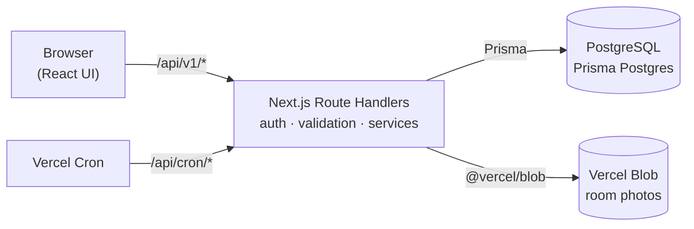

<div align="center">

# MeetingHub

**A meeting room booking platform that cannot be double-booked.**

Find a room, book it in seconds, get it approved, and check in with a QR code.


</div>

MeetingHub is one Next.js application: the interface and the API ship in the same deployment, data lives in
PostgreSQL (Prisma Postgres on Vercel), and room photos live in Vercel Blob. There is no separate backend to run.

## Contents

- [Highlights](#highlights)
- [Features](#features)
- [How it works](#how-it-works)
- [Quick start](#quick-start)
- [Deploy to Vercel](#deploy-to-vercel)
- [Configuration](#configuration)
- [Development](#development)
- [Reference](#reference)
- [Security](#security)

## Highlights

- **No double bookings, guaranteed by the database.** A PostgreSQL exclusion constraint rejects overlapping bookings
  even when two people click at the same instant. Application checks give friendly errors; the constraint is the guarantee.
- **Approval workflow.** Rooms can require approval; managers approve or reject with a written reason, and the
  requester is notified.
- **QR check-in.** A screen at the room shows a QR code that renews every 30 seconds, so a photo of it soon stops
  working. Unclaimed bookings become no-shows and the room is released.
- **Serverless by design.** Rate limits, job locks and sessions live in the database, uploads in Vercel Blob,
  and background work runs from Vercel Cron, so it scales without a server to babysit.
- **Tested against a real database.** The API test suite runs the real route handlers against a real PostgreSQL.

## Features

**Booking**

- Room search by capacity, building and equipment, with live availability
- One-time and weekly recurring bookings, limited by room opening hours and a 30-day advance window
- Cancel one meeting or a whole weekly series; invite colleagues by name or email
- Shared calendar, per-room day timeline, personal bookings and a list of meetings you are invited to

**Operations**

- Room management: create, edit, activate or deactivate, upload photos (JPG, PNG, WebP)
- Maintenance blocks that take rooms out of circulation
- Dashboard, monthly booking reports with CSV export, and an audit log of who changed what
- In-app notifications for invitations, approvals, cancellations and check-in reminders

**Accounts and security**

- Email and password sign-in with an HTTP-only session cookie, revocable on sign-out
- Roles: User, Facility Admin, Admin; temporary passwords that must be replaced at first sign-in
- Login and password-reset rate limiting; the password reset request goes to the administrators

| Role | Can do |
| --- | --- |
| User | Search rooms, create and manage own bookings, check in |
| Facility Admin | Everything a User can, plus rooms, photos, maintenance, approvals and reports |
| Admin | Everything above, plus users, password resets and the audit log |

## How it works



| Layer | Technology |
| --- | --- |
| App and API | Next.js 15 (App Router), React 19, TypeScript, Route Handlers under `app/api/v1` |
| Data | PostgreSQL through Prisma, Prisma Migrate |
| Validation | Zod |
| Auth | JWT session cookie (`jose`), Argon2id (`@node-rs/argon2`) |
| Storage | Vercel Blob |
| Background work | Vercel Cron plus a throttled, traffic-triggered sweep |
| Tests | Vitest, with API tests against a real PostgreSQL |

```text
apps/web
├── app/api/v1      API route handlers (thin: parse, authorize, call a service)
├── app/api/cron    Vercel Cron targets
├── app, features   Pages and UI
├── lib/server      Business rules, auth, validation, Prisma access
├── prisma          schema.prisma, migrations, seed script
├── tests           Unit tests and API integration tests
└── vercel.json     Build command and cron schedule
```

## Quick start

Requires **Node.js 20+**. No Docker and no database to install: a local PostgreSQL starts with one command.

```bash
cd apps/web
npm install                 # also generates the Prisma client
cp .env.example .env        # PowerShell: Copy-Item .env.example .env
npm run db:local            # terminal 1: local PostgreSQL, keep it running
```

In a second terminal:

```bash
cd apps/web
npm run db:migrate          # create the schema
npm run db:seed             # demo users, equipment and rooms
npm run dev
```

Open <http://localhost:3000> and sign in with a demo account:

| Role | Email | Password |
| --- | --- | --- |
| Admin | `admin@meetinghub.com` | `Admin123!` |
| User | `user@meetinghub.com` | `User123!` |

The local database listens on port 54329 and keeps its data in `apps/web/.local-db` (ignored by Git; delete it to start
over). Any PostgreSQL 14+ server with the `btree_gist` extension also works: set `DATABASE_URL` in `.env`.
Room photo upload needs a Vercel Blob token; everything else works without one.

## Deploy to Vercel

One Vercel project hosts everything.

1. **Import the repository** and set **Root Directory** to `apps/web`. `vercel.json` sets the build command: generate
   the Prisma client, apply migrations, build Next.js.
2. **Add Prisma Postgres** (Project → Storage → Create → Prisma Postgres). It provides `POSTGRES_URL`, a direct
   `postgres://` connection string, and the app and the build use it automatically (a custom prefix such as
   `STORAGE_POSTGRES_URL` works too). Make sure the variable is enabled for the **Production** environment. To use another PostgreSQL, set
   `DATABASE_URL` yourself. The `prisma+postgres://` Accelerate URL is not supported; the build says so if you use it.
3. **Add Vercel Blob** (Storage → Create → Blob). This sets `BLOB_READ_WRITE_TOKEN` automatically.
4. **Set the remaining variables** for Production:
   - `SECRET_KEY`: a unique random value of at least 32 characters
     (`node -e "console.log(require('crypto').randomBytes(48).toString('base64url'))"`)
   - `CRON_SECRET`: any long random string; Vercel Cron sends it as a bearer token
   - `NEXT_PUBLIC_APP_URL`: your public address, such as `https://rooms.example.com` (used in the sitemap and QR codes)
5. **Deploy.** Migrations run during the build.
6. **Create the first administrator.** Seed once with `DEMO_MODE=true`, sign in as `admin@meetinghub.com`, create the
   real administrator under **Employees & roles**, then deactivate the demo users and turn `DEMO_MODE` off:

   ```bash
   cd apps/web
   vercel env pull .env --environment=production
   npm run db:seed
   rm .env
   ```

> **Preview deployments do not run migrations** by default, so a branch with an unreleased migration cannot change the
> production database. Give Preview its own database and set `MIGRATE_PREVIEW=true` if previews should migrate it.
>
> **The build stops with a clear message** when no database is configured for Production, instead of failing deep inside Prisma.

<details>
<summary><strong>Background jobs and Vercel limits</strong></summary>

Check-in reminders, no-show marking and the demo reset cannot run as a long-lived process on Vercel.

- `vercel.json` registers two cron jobs. On the **Hobby** plan a cron job runs at most once a day, so the sweep is
  scheduled daily (`0 0 * * *`). On **Pro**, change it to `* * * * *` for a once-a-minute sweep.
- Any signed-in request that loads notifications, the calendar or "my bookings" also triggers a sweep in the background,
  at most once per `STATUS_SWEEP_INTERVAL_SECONDS` (60 by default). The sweep is claimed atomically in the database,
  so concurrent instances never run it twice. While anyone has the site open, reminders and no-shows stay current
  even on Hobby; with nobody using it, they catch up on the next visit or the daily cron.
- Admins can run the sweep on demand with `POST /api/v1/jobs/expire-no-shows`.
- Request bodies are limited to 4.5 MB on Vercel, so room photos are limited to **4 MB**.
- Rate limits, the sweep lock and the demo reset keep their state in PostgreSQL, because serverless instances share
  no memory or disk.

</details>

<details>
<summary><strong>Public demo mode</strong></summary>

Set `DEMO_MODE=true` to run a try-it-out instance. A daily cron job (`/api/cron/demo-reset`, 00:00 Asia/Bangkok in
[vercel.json](apps/web/vercel.json)) deletes all bookings, notifications, audit entries, uploaded photos and any users
or rooms people added, then restores the seeded accounts and rooms. Seed once beforehand. Set
`NEXT_PUBLIC_SHOW_DEMO_ACCOUNTS=true` to list the demo accounts on the sign-in page. **Never enable demo mode on a
database that holds real data.**

</details>

## Configuration

Copy [apps/web/.env.example](apps/web/.env.example) to `.env`. Never commit `.env`.

| Variable | Default | Purpose |
| --- | --- | --- |
| `DATABASE_URL` | required | Direct PostgreSQL connection string. `POSTGRES_URL` (from Prisma Postgres), or a prefixed one such as `STORAGE_POSTGRES_URL`, is used when it is unset. |
| `SECRET_KEY` | required | Signs session and check-in tokens. In production: unique, at least 32 characters. |
| `APP_ENV` | automatic | `development`, `test` or `production`. Vercel production counts as `production`: `Secure` cookies, weak secrets rejected. |
| `BLOB_READ_WRITE_TOKEN` | none | Vercel Blob token for photo uploads. Without it uploads answer `503`. |
| `CRON_SECRET` | none | Bearer secret for `/api/cron/*`. Without it those endpoints answer `503`. |
| `FACILITY_TIMEZONE` | `Asia/Bangkok` | Timezone for opening hours and daily metrics. |
| `ACCESS_TOKEN_EXPIRE_MINUTES` | `480` | Session lifetime. |
| `STATUS_SWEEP_INTERVAL_SECONDS` | `60` | Minimum gap between traffic-triggered sweeps; `0` disables them. |
| `LOGIN_MAX_ATTEMPTS` / `LOGIN_WINDOW_MINUTES` | `5` / `15` | Failed sign-ins allowed per client and email before a lockout. |
| `MIGRATE_PREVIEW` | `false` | Run migrations on Vercel Preview deployments (Production always migrates). |
| `DEMO_MODE` | `false` | Daily data reset, and allows seeding in production. |
| `NEXT_PUBLIC_APP_URL` | production domain | Public address for the sitemap, social previews and QR codes. Set it before building. |
| `NEXT_PUBLIC_SHOW_DEMO_ACCOUNTS` | development only | List demo accounts on the sign-in page. |
| `EXTRA_CORS_ORIGINS` | empty | Extra origins allowed to send cookie-authenticated writes (comma separated). |
| `SESSION_COOKIE_DOMAIN` | unset | Only for sibling subdomains, such as `.example.com`. |

## Development

Run from `apps/web`:

```bash
npm run dev                 # development server
npm run lint
npm run typecheck
npm run test                # unit tests and API integration tests
npm run build               # prisma generate + next build
npm run db:local            # local PostgreSQL, no Docker
npm run db:migrate          # apply migrations
npm run db:migrate:dev      # create a migration after changing prisma/schema.prisma
npm run db:seed             # demo data
npm run db:studio           # browse the database
```

The API tests (`tests/server`) call the real route handlers against a real PostgreSQL that starts automatically
(the `embedded-postgres` dev dependency), apply the committed migrations, and never touch development data.
Set `TEST_DATABASE_URL` to use a server you provide instead; the tests empty its tables.

After changing `prisma/schema.prisma`, run `npm run db:migrate:dev -- --name describe_the_change`, review the generated
SQL and commit the new migration. Never edit a migration that has already been deployed.

## Reference

<details>
<summary><strong>Booking rules</strong></summary>

- A booking lasts at most 4 hours, starts in the future, and starts at most 30 days ahead.
- It must fall inside the room's opening hours, interpreted in `FACILITY_TIMEZONE`.
- Two active bookings can never overlap in the same room: the API checks, and the PostgreSQL exclusion constraint
  `bookings_no_overlap` (created by the first migration) guarantees it under concurrent requests.
- Weekly recurrence creates one booking per week while the start stays within the 30-day window.
- Rooms marked "requires approval" create `PENDING_APPROVAL` bookings that a Facility Admin or Admin approves or
  rejects. Rejecting requires a reason. Moving a booking to a new room or time applies the approval rule again.
- Check-in opens 15 minutes before the start and closes 15 minutes after it. Confirmed bookings not checked in by then
  become `NO_SHOW`; checked-in bookings become `COMPLETED` when they end.

</details>

<details>
<summary><strong>QR check-in</strong></summary>

In **Rooms & people → Room management**, **Check-in screen** opens a full-screen page for that room. Leave it open on a
tablet or monitor at the room, signed in as a manager. The QR code renews every 30 seconds and each code stops working
120 seconds after it is issued.

Scanning opens the site, asks the person to sign in if needed, and checks in their own confirmed booking for that room
when its window is open. Because the code keeps changing, a photo of the screen soon stops working. It does not prove
where the phone is, and the person still has to be the organizer of a booking that is due. Check-in from the booking
list needs no code.

The QR code contains the address people use to reach the site, so set `NEXT_PUBLIC_APP_URL` (or open the screen from that
address). `localhost` only works on the computer running the site, and the screen warns when it is using it.

</details>

<details>
<summary><strong>Notifications, password resets and reports</strong></summary>

- **Notifications** appear under the bell in the top bar and refresh every minute while the tab is visible. They cover
  invitations, changes, cancellations, approval requests, decisions, check-in reminders, no-shows and password reset
  requests. Nothing is sent by email: no mail server is configured.
- **Forgotten passwords:** "Forgot your password?" notifies the Admins, who issue a temporary password under
  **Employees & roles → Reset password**; the user must replace it at the next sign-in. Requests are rate limited and the
  page answers the same whether or not the account exists.
- **Reports:** Booking health covers all time or one month and exports the same period as CSV in `FACILITY_TIMEZONE`.
  Cancelled and rejected requests do not count as room use. The export holds at most 50,000 rows.
- **Room photos:** JPG, PNG or WebP up to 4 MB, checked by type and file signature, stored in Vercel Blob. Replacing or
  deleting a photo removes the old file; bundled photos and external URLs are never deleted.

</details>

<details>
<summary><strong>API overview</strong></summary>

Route handlers live in `apps/web/app/api/v1`, business rules in `apps/web/lib/server`. Bodies and queries are validated
with the Zod schemas in [validation.ts](apps/web/lib/server/validation.ts); unknown properties are ignored. All
date-times must include a UTC offset. Errors use one shape:
`{"error": {"code": "ROOM_UNAVAILABLE", "message": "...", "field": "starts_at"}}`.

| Path | Purpose |
| --- | --- |
| `/auth` | Login, logout, current user, password change, forgot-password |
| `/users` | User management and password reset (Admin) |
| `/rooms`, `/facilities` | Room search and management, availability, day occupancy |
| `/rooms/{id}/image` | Upload or delete a room photo |
| `/rooms/{id}/check-in-token`, `/rooms/{id}/check-in` | QR check-in code (managers) and scan target |
| `/bookings` | Create, update, cancel (one or series), approve, reject, check in, list |
| `/bookings/invited`, `/bookings/schedule`, `/booking-policy` | Invitations, shared calendar, enforced limits |
| `/maintenance` | Maintenance blocks |
| `/dashboard`, `/reports/summary`, `/reports/bookings.csv` | Metrics and export |
| `/audit-logs` | Who changed what (Admin) |
| `/api/cron/sweep`, `/api/cron/demo-reset` | Cron targets, protected by `CRON_SECRET` |

`GET /health` and `GET /ready` are available for monitoring.

</details>

## Security

- Authorization is enforced on the server for every protected endpoint; hidden buttons are not the security boundary.
- Passwords are Argon2id hashes. Sessions live in an `HttpOnly`, `SameSite=Lax` cookie (`Secure` in production), and
  cookie-authenticated writes from unknown origins are rejected.
- Signing out, changing a password or an admin reset revokes the user's existing sessions.
- Failed sign-ins are rate limited per client and email, counted in PostgreSQL so every serverless instance shares them.
  The client address comes from `x-forwarded-for`, which Vercel sets itself; behind another host, make sure your proxy
  overwrites that header.
- Cron endpoints refuse every request without `CRON_SECRET` and fail closed when it is not configured.
- Responses never include password hashes or internal columns; unexpected errors return a generic message.
- The app refuses to start in production with a placeholder `SECRET_KEY`. Never use the demo credentials on real data.

## License

No license has been selected yet. Add a `LICENSE` file (for example MIT) before distributing the project publicly.
